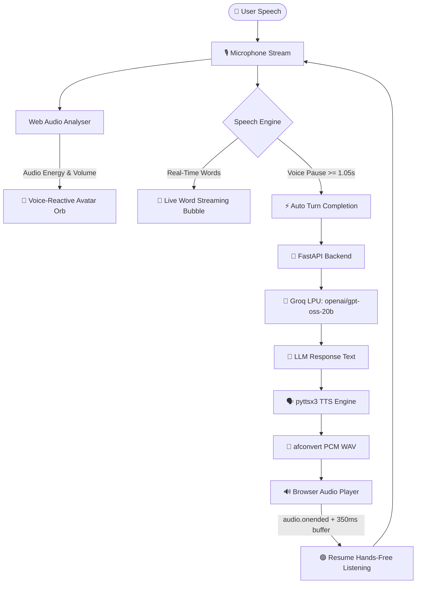

<div align="center">

# 🎙️ Real-Time Voice AI Studio

**Listen · Transcribe · Reason · Speak**

An ultra-low-latency, hands-free conversational voice AI studio powered by Groq LPU inference, Whisper transcription, and a voice-reactive fluid avatar orb inspired by next-generation voice interfaces.

[](https://python.org)
[](https://fastapi.tiangolo.com)
[](https://groq.com)
[](https://console.groq.com)
[](https://console.groq.com)
[](LICENSE)
[](https://apple.com)

[🚀 Quickstart](#-quickstart) · [✨ Core Capabilities](#-core-capabilities) · [🧠 Models](#-models--specifications) · [🎙️ Voice Modes](#-interaction-modes) · [🛠️ Architecture](#%EF%B8%8F-architecture)

</div>

---

## ✨ Core Capabilities

| Capability | Behavior & Technology |
|---|---|
| 🟢 **Hands-Free Live Mode** | **One-click continuous dialogue.** Starts with a single click; listens continuously, automatically detects natural pauses ($\sim 1.05\text{s}$) to submit turns, plays spoken answers, and seamlessly resumes listening without touching any button. |
| ⚡ **Live Word Streaming** | **Zero-latency interim transcription.** Words and syllables appear on-screen in real time as you speak them, complete with a live pulsating speech indicator. |
| 🔮 **Voice-Reactive Avatar Orb** | **Futuristic morphing gradient sphere.** Built with multi-layered fluid CSS/SVG nebula effects that physically scale, morph, and pulse in real time to your microphone's volume levels. |
| 🔴 **Push-to-Talk Mode** | **Hold or click to talk.** Quick voice messaging with real-time speech transcription displayed live, auto-sending on release. |
| 🗣️ **Local High-Fidelity TTS** | **Instant offline synthesis.** Fast native text-to-speech with automatic macOS true PCM WAV conversion (`afconvert`) for crystal-clear browser audio playback. |
| 💬 **Multimodal Text & Voice** | **Flexible interaction.** Seamlessly switch between keyboard text chat and voice dialogue with full context retention. |
| 🛡️ **Echo-Guard Isolation** | **Feedback loop prevention.** Mutes microphone listening while the AI speaks and applies an echo clearance buffer before resuming listening. |

---

## 🛠️ Architecture



---

## 🧠 Models & Specifications

| Component | Default Model / Engine | Provider | Latency / Purpose |
|---|---|---|---|
| **Language Model (LLM)** | `openai/gpt-oss-20b` | Groq LPU Cloud | Ultra-low-latency conversational reasoning (~180ms) |
| **Streaming Speech-to-Text** | `Web Speech API` (`webkitSpeechRecognition`) | Browser Native Engine | Zero-network-latency word-by-word streaming display |
| **Cloud Speech-to-Text** | `whisper-large-v3-turbo` | Groq Cloud Whisper API | High-accuracy transcription fallback |
| **Text-to-Speech (TTS)** | `pyttsx3` + `afconvert -f WAVE -d LEI16` | Native OS Speech Engine | Instant local audio synthesis with universal browser playback |
| **Audio Visualizer** | `AnalyserNode` (FFT Size: 256) | Web Audio API | Real-time audio frequency tracking and orb modulation |

> **Configurable:** All models can be customized in your `.env` file (`LLM_MODEL` and `WHISPER_MODEL`).

---

## 🎙️ Interaction Modes

### 1 · 🟢 Hands-Free Live Mode
- **Activate:** Click the green **Live Mode** button (or click the central avatar orb).
- **Speak naturally:** Words render on-screen in real time as you speak.
- **Natural pauses:** When you stop speaking for $\sim 1.05\text{s}$, the system automatically:
  1. Finalizes your message bubble.
  2. Queries Groq LLM.
  3. Synthesizes and plays the spoken audio.
  4. Automatically transitions back to listening hands-free.
- **Deactivate:** Click the green **Live Mode** button again to exit.

### 2 · 🔴 Push-to-Talk (Voice Mode)
- **Hold or click** the red microphone button.
- Words appear live in the message bubble as you speak.
- Release (or click stop) to instantly get the AI's response and spoken playback.

### 3 · 💬 Text Chat
- Type your prompt into the floating glassmorphism input bar and press **Enter** or click **Send**.
- Responses appear with markdown formatting and are spoken aloud automatically.

---

## 🚀 Quickstart

### 1 · Clone and Navigate

```bash
git clone https://github.com/BrunoMelicio/claude_code_test.git
cd claude_code_test
```

### 2 · Setup Virtual Environment

```bash
# Create Python 3.12 virtual environment
python3 -m venv venv

# Activate virtual environment
source venv/bin/activate  # Windows: venv\Scripts\activate

# Install dependencies
pip install -r requirements.txt
```

### 3 · Configure Environment Variables

1. Get a free API key at [console.groq.com](https://console.groq.com/).
2. Copy `.env.example` to `.env` and insert your key:

```bash
cp .env.example .env
```

```env
# Groq API Key
GROQ_API_KEY=your_groq_api_key_here

# Model Configuration (Optional)
LLM_MODEL=openai/gpt-oss-20b
WHISPER_MODEL=whisper-large-v3-turbo

# Server Port (Optional, default 8000)
PORT=8001
```

### 4 · Launch the Application

```bash
# Run server using Uvicorn
python main.py
```

Open your browser and navigate to:
```
http://localhost:8001
```

---

## 🎨 UI Design Highlights

- **Gemini & Claude Inspired Interface**: Minimalist OLED dark theme (`#0a0b10`) with ambient radial mesh lighting and modern typography (*Plus Jakarta Sans* & *Inter*).
- **Dynamic Avatar Stage**: Centerpiece morphing fluid orb with internal nebula swirls, specular glass highlights, and outer bloom glow.
- **Voice-Reactive Feedback**: As speech energy changes, CSS variables `--voice-scale` and `--voice-glow-size` dynamically animate the avatar.
- **Floating Input Pill**: Seamless rounded glassmorphism bar featuring model selection, mic controls, hands-free toggle, and quick-prompt chips.
- **Collapsible Sidebar**: Quick session management, API connectivity monitoring, and microphone health checks.

---

## 📂 Project Structure

```
.
├── main.py              # FastAPI server, Groq API client, STT, and TTS engine
├── requirements.txt     # Python dependencies (FastAPI, Groq, pyttsx3, httpx)
├── .env.example         # Template for environment variables and model selection
├── CLAUDE.md            # Architecture conventions, routes, and development guide
├── README.md            # Project documentation and visual overview
└── static/
    └── index.html       # Single-page UI with Web Audio, Web Speech API, and fluid orb
```

---

## 🔍 Troubleshooting

| Issue | Cause | Solution |
|---|---|---|
| **Microphone blocked** | Browser permissions denied | Click the camera/microphone icon in your browser address bar and grant permission for `localhost`. |
| **No audio output on macOS** | pyttsx3 default AIFC format | The included `afconvert` pipeline automatically converts audio to true PCM WAV for universal browser support. |
| **No audio output on Linux** | Missing speech engine | Install espeak: `sudo apt install espeak libespeak-dev`. |
| **API error 404 on Groq** | Deprecated model ID | Ensure `LLM_MODEL=openai/gpt-oss-20b` and `WHISPER_MODEL=whisper-large-v3-turbo` in your `.env`. |
| **Web Speech blocked in Brave** | Brave shields Google services | Built-in audio chunk streaming fallback automatically transcribes speech via Groq Whisper API. |

---

## 📜 License

This project is licensed under the [MIT License](LICENSE).
